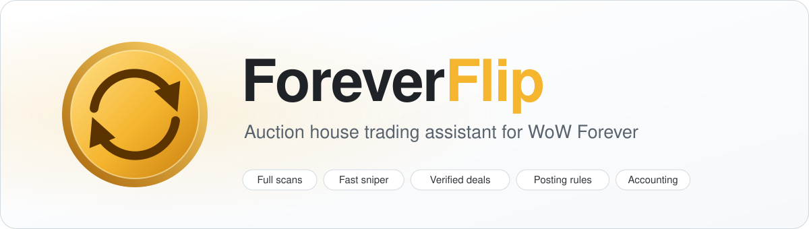

<div align="center">
  <picture>
    <source media="(prefers-color-scheme: dark)" srcset=".github/assets/hero-dark.svg" />
    
  </picture>
</div>

<p align="center">
  <a href="https://github.com/Danissemo/ForeverFlip/releases/latest"></a>
  <a href="https://github.com/Danissemo/ForeverFlip/actions/workflows/ci.yml"></a>
  <a href="https://github.com/Danissemo/ForeverFlip/releases"></a>
  
  
  <a href="LICENSE"></a>
</p>

<h3 align="center">
  Scan the whole auction house, find lots worth flipping, check them live and buy, post and track profit, all from one tab.
</h3>

<p align="center">
  <a href="docs/user-guide.md">User guide</a> ·
  <a href="docs/how-it-works.md">How it works</a> ·
  <a href="CHANGELOG.md">Changelog</a> ·
  <a href="https://github.com/Danissemo/ForeverFlip/releases/latest">Download</a>
</p>

> [!IMPORTANT]
> **ForeverFlip never trades on its own.** Every purchase, bid, post and cancel starts with your click
> or key press. In the background it only reads the auction house, at the pace the server allows.

> [!CAUTION]
> Download ForeverFlip only from the [Releases](https://github.com/Danissemo/ForeverFlip/releases) page
> of this repository. GitHub shows the SHA-256 of every file on the release page; compare it with
> `certutil -hashfile ForeverFlip-<version>.zip SHA256` (Windows) or `sha256sum` (Linux, macOS).

## ✨ Feature highlights

**Finding deals**

- **Full scans:** every auction of the house, often more than 200 000, read in small portions so
  the game never freezes. One per 15 minutes, optionally automatic while the auction house is open, and scans
  of other addons are read too.
- **Fast sniper:** browse rounds read the lowest price of every item in seconds; hot items and your
  shopping list are re-read 100 at a time; every suspicious price is checked at once.
- **Vendor deals:** lots below what a vendor pays. Buy, sell to any merchant, keep the difference,
  with no market risk. The real price a merchant pays is learned from the buyback list, because
  WoW Forever's server pays less than the game's item data for some items.
- **Resale:** lots far below the next seller, for items that really sell at the resale price.
  - Sales are tracked auction by auction.
  - Profit counts the auction cut and the deposit risk.
- **Shopping list:** your items and your price; cheaper lots become deals.
- **Disenchant deals** for enchanters.
- **Bids** on auctions about to end.
- **Crafting:** what is worth crafting, priced from your recipes, auction and merchant prices.
- **Live check:** nothing can be bought until an exact search confirms the deal in the last 5 minutes.
- **Alerts:** a sound, a screen message and a green mark in the game's Buy tab.

**Selling**

- **Posting rules:** undercut by a step or a percent, minimum and maximum price, units to keep, hold
  below the minimum. Never below your break-even.
- **Post next bought / Post all:** all available units across bag stacks, one click per item, at the right price and the selected duration
  (24 hours by default, or **Auto**).
- **Cancel undercut:** cancels undercut auctions one by one, only when the repost still pays.
- **One-click chores:** take all auction mail, sell all vendor deals at a merchant.

**Accounting and analytics**

- **Books from auction mail:** the real sale amounts, the learned cut, and the sale rate of every item.
- **Analytics:**
  - profit per day, return and hit rate;
  - best and worst items;
  - gold and stock of all your characters;
  - market lists and the time-of-week price pattern.
- **History:** a 14-day price chart for any item (right-click), and tooltip prices with their age.
- **Shared scans:** pool full scans with every ForeverFlip user of your realm over a hidden channel,
  with your guild, group or friends, or with the whole community through GitHub ([ForeverFlip Sync](docs/community.md)); full scans are archived unchanged
  in [ForeverFlip-Data](https://github.com/Danissemo/ForeverFlip-Data).
- **Export:** the journal as CSV.
- **Safety:** a spending limit per visit, cheap lots left for others, and tooltip advice: vendor,
  disenchant or auction house.
- **Comfort:** key bindings (including "buy the next best deal"), Careful / Balanced / Aggressive
  presets, `ForeverFlipAPI` for other addons, English and Ukrainian.

## 📦 Installation

1. Download `ForeverFlip-<version>.zip` from the [latest release](https://github.com/Danissemo/ForeverFlip/releases/latest).
2. Unpack it into `Interface/AddOns/` of your WoW Forever client, so that the file
   `Interface/AddOns/ForeverFlip/ForeverFlip.toc` exists.
3. Restart the game or type `/reload`, and make sure ForeverFlip is enabled in the AddOns list.
4. Optional:
   - bind keys under **Key Bindings → AddOns → ForeverFlip**;
   - open each profession window once, so the Crafting page knows your recipes.

> [!NOTE]
> **Current beta: [2.1.0-beta.2](https://github.com/Danissemo/ForeverFlip/releases/tag/v2.1.0-beta.2)**
> fixes full scans that lost most items of a busy auction house, loads item data much faster
> after a scan, and makes the Sync helper fast (a few seconds after `/reload` instead of a minute),
> able to keep syncing in the tray, with a turning status ring. In game, Settings → Sharing now
> tells which of your scans the helper shared. Includes 2.1.0-beta.1 (a full code review) and all
> earlier betas. Download the new helper EXE as well as updating the addon. See the
> [current beta checklist](docs/testing.md#current-beta-checklist) and
> [Beta testing](docs/testing.md#beta-testing).

> [!TIP]
> To update, replace the `ForeverFlip` folder, or let the
> [ForeverFlip Sync helper](docs/community.md#addon-updates-and-beta-testing) do it: it installs new
> releases by itself, and new betas too if you tick **Beta tester**. Your data lives in
> `WTF/Account/<ACCOUNT>/SavedVariables/ForeverFlip.lua` and is kept.

| Requirement | |
|---|---|
| Game | WoW Forever, client 1.60.1 (Interface `16001`) |
| Dependencies | None |
| Optional | [LibAHTab](https://www.curseforge.com/wow/addons/libahtab) puts the tab next to other addon tabs. [auxForever](https://github.com/TylerHampton/aux-forever) prices fill in materials ForeverFlip has not seen yet |
| Works next to | Auctionator, TradeSkillMaster and other auction addons |

## 🚀 Quick start

1. Open the auction house and click the **ForeverFlip** tab.
2. Click **Full scan** and let the progress bar finish. Automatic scans and the sniper can be enabled in Settings.
3. Open **Deals → To vendor** and click a deal. It is checked live; when it says **ready**,
   click **Buy**. For stackable goods, also click **Confirm purchase** once the game quotes the price.
4. Sell vendor deals, and everything else a merchant pays the most for, at any merchant with
   **Sell to vendor**. Post resale purchases with
   **Selling → My items → Post next bought**.

Resale deals need sales data, so they start to appear after two or three full scans (30–45 minutes
with the auction house open).

## ⌨️ Commands and key bindings

| Command | Action |
|---|---|
| `/ff` | Version and a short hint |
| `/ff diag` | Statistics of the last full scan |
| `/ff rescan` | Allow a full scan right away after the server did not answer |
| `/ff export` | The journal as CSV, ready to copy |
| `/ff lang en` · `/ff lang uk` | Switch the language (after `/reload`) |

The Key Bindings window has five bindings (also set on **Settings → Key bindings**):

- Buy or confirm the selected deal
- Buy the next best deal (each press: check, buy, confirm)
- Post next bought (then Post all)
- Cancel the next undercut auction
- Full scan

## 📚 Documentation

| Document | What is inside |
|---|---|
| [User guide](docs/user-guide.md) | Every page, button, status, setting and message |
| [How it works](docs/how-it-works.md) | Scans, the sniper, sales tracking, deal maths, limits and safety rules |
| [Architecture](docs/architecture.md) | Modules, load order, events and data flow |
| [Saved data](docs/saved-data.md) | Layout of the `ForeverFlipData` SavedVariables file |
| [Community scans](docs/community.md) | The ForeverFlip Sync helper and the community data repository |
| [API](docs/api.md) | `ForeverFlipAPI` for other addons |
| [Testing](docs/testing.md) | Ukrainian test steps and a [fillable tester worksheet](docs/tester-checklist.uk.xlsx) |

## ❓ Questions and answers

### There are no deals after a scan

- Vendor deals depend on the market at that moment; often there are none.
- Resale needs sales data from two or three scans.
- Check the minimums in **Settings**, or try the **Aggressive** preset.
- `/ff diag` shows how many items are still collecting data.

### The Buy button stays grey

A deal can be bought only when it is **ready**, checked in the last 5 minutes, while no other search
or purchase runs. Click the deal to check it again.

### The scan does not start

The server allows one full scan per 15 minutes **per account**, and another addon may have used the
window. Wait for the countdown on the button, or use `/ff rescan` if the server did not answer.

### Is the profit guaranteed?

No. Other players see the same lots, and sales are an estimate. Several safeguards limit the risk:

- each resale buys at most about one day of sales;
- the resale price is capped at what real sales reached;
- items whose stock does not sell, or keeps coming back unsold, are trusted less;
- a purchase that fails because someone was faster costs nothing.

### What has not been confirmed on WoW Forever yet?

These are taken from Classic and checked in a simulated client only:

- the 15% cut of neutral auction houses, which is corrected from your sale invoices;
- the disenchanting table.

The [in-game checklist](docs/testing.md#in-game-checklist) lists what to try.

### Can someone spoil the community prices with a fake scan?

Not easily. Anyone with a GitHub account can share scans, but:

- every scan is sealed by the addon while it reads it, so a scan edited afterwards is refused;
- a scan reaches the community prices only when another player's scan confirms it, and only with the
  items whose prices agree;
- deals always come from your own scans and live checks.

See [Safeguards](docs/community.md#safeguards).

### How do I report a bug?

1. Type `/reload`.
2. Copy the `errors` section of `WTF/Account/<ACCOUNT>/SavedVariables/ForeverFlip.lua`, plus the
   output of `/ff diag`.
3. Paste both into a [bug report](https://github.com/Danissemo/ForeverFlip/issues/new/choose).

Questions go to [Discussions](https://github.com/Danissemo/ForeverFlip/discussions). A security
problem is reported privately: see the [security policy](SECURITY.md).

## 🛠️ Local development

You need Python 3.12 and [StyLua](https://github.com/JohnnyMorganz/StyLua). The tests run the real
addon code in Lua 5.1 through [lupa](https://github.com/scoder/lupa), against a simulated WoW client
and auction house.

```bash
python -m pip install -r requirements-dev.txt
python tools/devflow.py test          # one process per module; `test <word>` narrows it
stylua --check ForeverFlip
python -m pyflakes sync tools tests
python tools/build.py
```

`tools/build.py` checks the TOC and the version, runs the tests, writes `dist/ForeverFlip-<version>.zip`
and prints its SHA-256.

## 🤝 Contributing

Bug reports, observations of how the WoW Forever server behaves, ideas and pull requests are welcome.

- [Contributing guide](CONTRIBUTING.md): the code style, tests, the local flow and releases.
- [Code of conduct](CODE_OF_CONDUCT.md): how we talk to each other.
- [Security policy](SECURITY.md): how to report a security problem privately.
- [Discussions](https://github.com/Danissemo/ForeverFlip/discussions): questions, ideas and beta
  feedback that is not a bug.

## 📄 License

ForeverFlip is released under the [MIT license](LICENSE).

<sub>World of Warcraft is a trademark of Blizzard Entertainment. ForeverFlip is a fan-made addon and
is not affiliated with or endorsed by Blizzard Entertainment.</sub>
